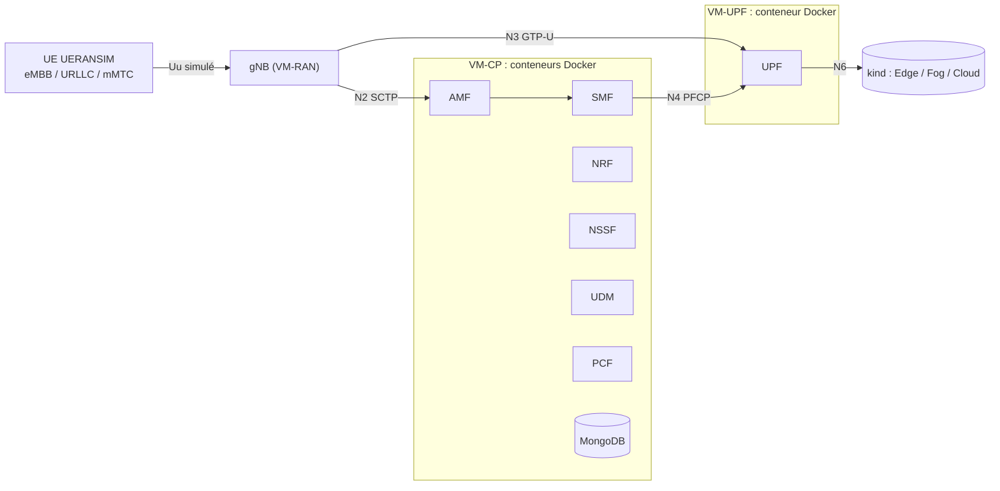

# Atelier 2 : Architecture et composants 6G

## 1. Objectif
Définir l'architecture 6G cible de la maquette et documenter les composants et les différences B5G/6G pour la partie Infrastructure et Cloud-native.

## 2. Schéma d'architecture

Version image : `archi.png`.

## 3. Composants

| Composant | Rôle | VM / conteneur | Port / interface |
|---|---|---|---|
| AMF | Accès et mobilité, enregistrement (N1/N2) | VM-CP / `amf` | 38412/sctp (NGAP) |
| SMF | Sessions PDU, pilote l'UPF (N4) | VM-CP / `smf` | 8805/udp (PFCP) |
| UPF | Plan usager, passerelle N6 | VM-CP puis VM-UPF / `upf` | 2152/udp (GTP-U), 8805/udp |
| NRF, SCP, NSSF, UDM, UDR, AUSF, PCF, BSF | Découverte, communication, slices, abonnés, authentification, politiques | VM-CP / un conteneur chacun | SBI HTTP/2 (127.0.0.x) |
| MongoDB | Base des abonnés | VM-CP / `mongo` | 27017/tcp (127.0.0.1) |
| gNB, UE (UERANSIM) | RAN et terminaux simulés | VM-RAN / `gnb`, `ue1` | Uu simulé (4997/udp), N2, N3 |
| kind (Edge/Fog/Cloud) | Calcul distribué, MEC | VM-K8S / 4 conteneurs kind | NodePort 30081 à 30083, 30101 à 30103 |

Réseau : VMnet2 (192.168.60.0/24) entre les VM : VM-CP .10, VM-UPF .11, VM-RAN .12, VM-K8S .20. Une carte NAT par VM donne l'accès à Internet.

## 4. Différences B5G / 6G (partie A)

| Domaine | B5G | 6G (ce projet) |
|---|---|---|
| Cœur | Monolithique, processus natifs | Fonctions réparties sur VM (atelier 7), conteneurs (ateliers 3 et 9) |
| Orchestration | Docker simple | Cloud-native avec Kubernetes, réplication et autoscaling (atelier 8) |
| Calcul | Cloud + Edge/MEC | Continuum UE, Edge, Fog, Cloud avec placement automatique (ateliers 10 et 11) |

## 5. Choix techniques justifiés
- **VMware + VM de niveau 1** : la virtualisation imbriquée est indisponible, donc aucune VM n'est lancée dans une VM.
- **kind** plutôt que des VM Kubernetes : 3 nœuds kind consomment environ 2 Go, contre environ 6 Go pour 3 VM.
- **Conteneurs Ubuntu 22.04 sur hôte Ubuntu 26.04** : les paquets Open5GS et MongoDB ne sont pas disponibles pour Ubuntu 26.04, et MongoDB 8 pose problème sur les noyaux 6.19 à 7.0.13.
- **MongoDB 6.0** avec `GLIBC_TUNABLES=glibc.pthread.rseq=1`.

## 6. Limites
- Pas de couche physique réelle : le RAN est simulé (UERANSIM).
- La 6G n'étant pas normalisée, ses fonctions sont modélisées au-dessus d'un cœur 5G (Open5GS).
- Les latences Edge/Fog/Cloud sont émulées par `tc netem`.
